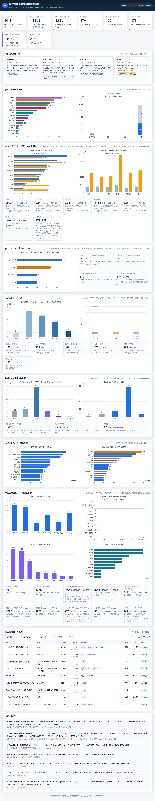

# Wuhan Tech Internship Jobs Dashboard

[](https://job.lingchuangshuati.com/)
[](https://www.python.org/)
[](https://www.djangoproject.com/)
[](https://www.mysql.com/)
[](#testing)

**English** · [中文文档](README.zh-CN.md)

**Live dashboard → <https://job.lingchuangshuati.com/>**

A Django + MySQL data service behind a job-market dashboard for computer-science internships in Wuhan.
It ingests a 3,013-row multi-platform snapshot, answers the dashboard's questions from SQL instead of
static JSON, and documents **every number** back to the query that produces it.

---

## Why this exists

The original dashboard was a single HTML page loading seven pre-computed JSON files. That works until you
want to change a filter, add a column, or ask a question the aggregator did not anticipate — then you
regenerate everything offline and hope the numbers still match.

This repo keeps the visual design and replaces the data layer:

- **SQL instead of frozen JSON** — filters, sorting and paging run server-side
- **Parity, not vibes** — each endpoint is compared field-by-field against the original JSON; all 37
  remaining differences are traced to a cause (see [`docs/ENDPOINTS-MAPPING.md`](docs/ENDPOINTS-MAPPING.md))
- **The audit is executable** — field statistics are produced by scripts, never typed by hand

| | |
| --- | --- |
| Postings | **3,013** (snapshot 2026-10-12) |
| Platforms | **4** — BOSS直聘 2,528 · 猎聘 245 · 智联招聘 172 · 实习僧 68 |
| Raw fields | **31**, incl. 5 that are >85% empty (kept on purpose, see [data model](#data-model)) |
| Tables | **14** |
| REST endpoints | **16** |
| Tests | **98** + 169 subtests |
| Docs | **10** files, 1,546 lines |

## Screenshot



## Architecture

```text
                    ┌──────────────────────────────────────┐
  snapshot JSON ───▶│ import_snapshot.py                   │
  (3,013 rows)      │  idempotent on job_uid               │
                    │  ON DUPLICATE KEY UPDATE             │
                    └──────────────┬───────────────────────┘
                                   │
                    ┌──────────────▼───────────────────────┐
                    │ MySQL 8.4  (14 tables)               │
                    │  jobs · job_stacks · job_tags        │
                    │  companies · job_descriptions        │
                    │  generated cols: day_mid_comparable, │
                    │                  intern_daily_sample │
                    └──────────────┬───────────────────────┘
                                   │  all SQL lives in
                    ┌──────────────▼───────────────────────┐
                    │ Django 6.1  (16 endpoints)           │
                    │  /api/stats/*  ← aggregates          │
                    │  /api/jobs     ← paged + filtered    │
                    │  /api/auth/*   ← bearer token        │
                    │  /api/favorites                      │
                    └──────────────┬───────────────────────┘
                                   │ JSON (same shapes as before)
                    ┌──────────────▼───────────────────────┐
                    │ static/dashboard/                    │
                    │  index.html + style.css unchanged    │
                    │  app.js: 2 functions changed         │
                    └──────────────────────────────────────┘
```

## Quick start

Requires MySQL 8.4 and Python 3.11+ (developed on 3.14.3).

```bash
git clone https://github.com/aschemanrudell-ship-it/wuhan-tech-intern-dashboard.git
cd wuhan-tech-intern-dashboard
python -m venv .venv
.venv/bin/pip install -r requirements.txt      # or: pip install django pymysql pytest
```

Start an isolated MySQL instance (this repo never touches your existing server):

```bash
mysqld --initialize-insecure --datadir=./work/mysql-data
mysqld --datadir=./work/mysql-data --port=3307 --skip-mysqlx &
mysql -u root -h 127.0.0.1 -P 3307 -e \
  "CREATE DATABASE jobdata CHARACTER SET utf8mb4 COLLATE utf8mb4_0900_ai_ci;"
mysql -u root -h 127.0.0.1 -P 3307 jobdata < sql/schema.sql
```

Load and run:

```bash
.venv/bin/python scripts/import_snapshot.py --port 3307   # run twice → still 3,013 rows
.venv/bin/python scripts/build_meta_fixture.py
.venv/bin/python manage.py runserver 127.0.0.1:8000
```

Open <http://127.0.0.1:8000/static/dashboard/index.html>.

> Windows note: the venv created by MSYS2 Python uses the POSIX layout (`.venv/bin/python.exe`).
> Run `mklink /J .venv\Scripts .venv\bin` if a tool expects `Scripts`.

## API

| Method | Endpoint | Purpose |
| --- | --- | --- |
| `GET` | `/api/health` | DB reachability + row counts |
| `GET` | `/api/stats/summary` | Replaces `summary.json` — 31 top-level keys |
| `GET` | `/api/stats/stacks` | 15 directions × counts, salary, degree, districts, top companies |
| `GET` | `/api/stats/tags` | Tags, filtered skills, companies, industries |
| `GET` | `/api/stats/companies` | Employer panel: two Top-15 lists + three distributions |
| `GET` | `/api/stats/inventory` | Platform-reported result counts (read from fixture) |
| `GET` | `/api/stats/tracks` | Intern → full-time progression, 8 directions |
| `GET` | `/api/jobs` | Paged + filtered + sorted job list |
| `GET` | `/api/jobs/{job_uid}` | One job with stacks, tags, labels, JD |
| `POST` | `/api/auth/register` | Create account (PBKDF2) |
| `POST` | `/api/auth/login` | Issue bearer token (SHA-256 stored) |
| `GET` | `/api/auth/me` | Current user |
| `POST` | `/api/auth/logout` | Revoke token |
| `GET` | `/api/favorites` | My favorites |
| `POST` | `/api/favorites` | Add (idempotent) |
| `DELETE` | `/api/favorites/{job_uid}` | Remove |

`/api/jobs` accepts `page`, `page_size` (≤200), `source`, `stack`, `degree`, `q`, `salary_only`,
`intern_daily_only`, `sort`, `order`. Sorting goes through a whitelist map, never string concatenation.

## Data model

14 tables. The non-obvious parts:

**`jobs`** — one row per posting, keyed by `job_uid` (source + `job_id`). Two generated columns carry
the salary semantics so no query can get it wrong:

```sql
day_mid_comparable  = salary_unit IN ('DAY','K_MONTH','K_MONTH_X')   -- 623 rows
intern_daily_sample = salary_unit IN ('DAY','K_MONTH','K_MONTH_X')
                      AND (salary_unit = 'DAY' OR title_has_intern = 1)  -- 504 rows
```

**Deliberately kept despite low coverage** — `publish_time` (94.3% missing), `durations` (96.2%),
job-description bodies (94.8%). They answer "when" and "what will I actually do", which no other field
can. Dropping them would have been cheaper and wrong.

**`companies`** — 1,954 rows. Employer profiles only exist for 84 companies, so profile fields are
nullable and front-end panels say "82 of 1,954" rather than pretending full coverage.

**Dedup** is deliberately *not* physical. 66 `(title, company)` groups repeat (162 rows), but only **2**
are genuine cross-platform duplicates. Merging them would silently drop real openings — a company posting
the same role under two platform accounts is not a duplicate. So the schema stores a `dup_group_key`
hash and leaves every row intact.

## The part that was actually hard

Five things the data did not tell us upfront.

### 1. Three salary scopes, not one

"Internship salary" is three different questions:

| Scope | Definition | Rows |
| --- | --- | ---: |
| A — wide | `is_intern = 1` | 1,096 |
| B — explicit | title contains 实习 | 765 |
| C — comparable | day-rate, or `K/month` **and** title says 实习 | 484 |

331 rows in A are counted as internships only because they matched "应届"/"校招" — they are stale
campus ads. Every endpoint states which scope it uses; `scope_notes` ships in the response body.

### 2. A silent data-loss bug in the tag dictionary

`tags.name` was created with `utf8mb4_0900_ai_ci` — case-**in**sensitive. `Java` (143 postings) and
`java` (2 postings) collapsed into one row, and the importer's lookup `tag_id["Java"]` then missed
every time. 143 links vanished without an error; the tag chart simply showed `MySQL` at the top.

Fix: `COLLATE utf8mb4_0900_as_cs`. Same treatment for `job_label_dict`. This is the kind of bug that
produces plausible-looking charts forever.

### 3. Two percentile algorithms, and the wrong one looks right

The original aggregator uses the **index method** `vals[int(n*p)]`, with **no rounding** on
p25/median/p75 (only the mean is rounded). Interpolation gives `p75 = 247.5` where the source says
`250`; on a 75-sample slice both algorithms agree, which is exactly why the bug hides.

It only surfaced on `PHP`, where `n = 1`: index method returns that single value, interpolation returns
`null`. Both algorithms are now implemented explicitly in `api/queries.py` and `api/stats_extra.py`
with a comment saying which endpoint uses which.

### 4. A wrong number in the source that the source itself contradicts

`summary.json` reports `total_open_jobs: 167,169`. The aggregator sums each company's job count **once
per posting**, so a company with 100 openings and 5 postings contributes 500. The correct figure is
**22,952** — which is what the project's own `company_panel.json` says. This repo uses the corrected
value and documents the contradiction.

### 5. A case-sensitive substring check that dropped 5 rows

`aggregate.py` did `"K" in salary_raw`. Five rows are written `3-5k`, `3-6k`, `4-7k`, `4-8k` — four of
them from 猎聘. Those rows were silently excluded from every monthly-salary statistic. Fixed with
`[kK]`; the 5-row delta is visible and explained in `docs/SUMMARY-MAPPING.md`.

### 6. The frontend migration had to preserve 78,232 characters

Swapping the data source without changing the design is not "close enough". Verification method: render
the original and the migrated page, screenshot both (identical 1280×6568), then diff
`document.body.innerText` character by character.

```
length: 78,232 vs 78,232
differing positions: 2
difference: footer timestamp (17:41:06 vs 17:41:27)
```

Everything else — every KPI, chart label, table row, conclusion paragraph — is byte-identical.

## Testing

```bash
.venv/bin/python -m pytest -q
# 98 passed, 169 subtests passed
```

Four groups:

1. **Scope tests** — the three salary scopes and their invariants
2. **API-vs-source** — `summary.json` compared field by field; 8 blocks must match exactly, the other
   5 assert *known* deltas so they can never drift silently
3. **Filter parity** — 17 cases comparing SQL results against the original JavaScript `applyFilters`
   re-implemented in Python, on the 3,013-row snapshot
4. **Auth & ownership** — unauthenticated → 401, A cannot delete B's favorite, duplicate favorite is
   idempotent

The parity trick matters more than the count: it tests the *port*, not just that code runs.

## Docs

| File | Contents |
| --- | --- |
| [`FIELD-AUDIT.md`](docs/FIELD-AUDIT.md) | Generated field statistics — presence, emptiness, dirty values |
| [`DESIGN.md`](docs/DESIGN.md) | Schema rationale, dedup policy, salary model, index plan |
| [`QUERIES.md`](docs/QUERIES.md) | The 8 queries the dashboard needs, with measured output |
| [`SUMMARY-MAPPING.md`](docs/SUMMARY-MAPPING.md) | `summary.json` → SQL, field by field, with every delta |
| [`ENDPOINTS-MAPPING.md`](docs/ENDPOINTS-MAPPING.md) | The other 5 endpoints, 37 diffs, all traced |
| [`API-JOBS.md`](docs/API-JOBS.md) | Paging contract, sort whitelist, LIKE escaping |
| [`API-AUTH.md`](docs/API-AUTH.md) | Token design, threat notes, three acceptance tests |
| [`FRONTEND-COMPAT.md`](docs/FRONTEND-COMPAT.md) | What changed in `app.js` and what did not |
| [`INDEX-STUDY.md`](docs/INDEX-STUDY.md) | Index candidates and the one that was measured and rejected |
| [`HANDOFF.md`](docs/HANDOFF.md) | Current state, gotchas, next steps |

## Known limitations

- **The deployed site runs the earlier static build.** <https://job.lingchuangshuati.com/> serves the
  pre-API version. The dashboard in `static/dashboard/` is the API-backed rewrite and needs this server
  running; deployment of the new build is still open.
- **No index has been proven necessary.** At 3,013 rows every candidate finished in ~2 ms, which is
  noise. One candidate was measured and rejected; the rest are listed but unproven.
- **8 high-pay pseudo-internships remain.** Monthly 10K–32.5K rows that pass the title filter (remote
  city / 2022 cohort / campus hire / support role). They do not move the median but they corrupt P75 and
  max. No rule yet — it needs data, not a threshold.
- **JD coverage is 5.2%** (156 rows, all 智联). BOSS's list API never returns bodies.
- **`publish_time` is 94.3% empty**, so "newest first" is nearly meaningless.
- **The dashboard still downloads the full 3,013-row payload** through a compatibility endpoint. Paging
  the table and moving the six chart panels onto aggregate endpoints is the next step; the endpoint side
  is already built.

## Roadmap

1. Frontend stage B — paged table, chart panels on aggregates, delete the compatibility endpoint
2. Replicate `jobs` to 200k rows and actually measure the index candidates
3. Decide the outlier rule with evidence
4. Deploy the API build to replace the static site
5. Login / favorites UI (the 7 endpoints exist; the dashboard has no buttons yet)

## Data & privacy

The snapshot is public job-posting data collected 2026-10-12 from BOSS直聘, 猎聘, 智联招聘 and 实习僧.
Recruiter display names are kept as published (`李女士`, `HR`) — they carry no identifying information.
One phone number that had been pasted into a skills field was redacted before publishing
(`scripts/sanitize_for_publish.py`). No accounts, no emails, no private user data.

Company names and salary figures belong to the original platforms; this repository claims no rights
over them.

## License

MIT for the code — see [`LICENSE`](LICENSE). The data is **not** covered and remains subject to the
source platforms' terms.
