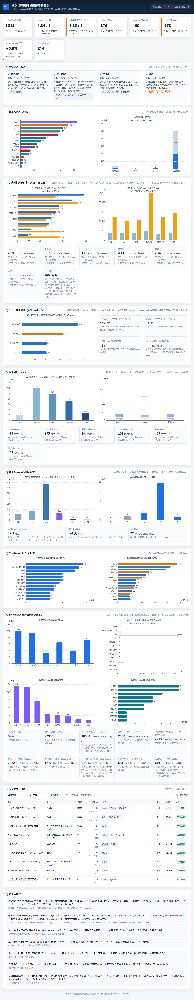

# 武汉计算机实习招聘看板

[](https://job.lingchuangshuati.com/)
[](https://www.python.org/)
[](https://www.djangoproject.com/)
[](https://www.mysql.com/)
[](#测试)

[English](README.md) · **中文**

**在线看板 → <https://job.lingchuangshuati.com/>**

一个把武汉计算机实习岗位数据从"静态 JSON 看板"改成"Django + MySQL 数据服务"的项目。
数据源是 3,013 条多平台岗位快照，看板的每一个数字都对应到产生它的那条 SQL，并且逐项与原始
JSON 做过对拍。

---

## 为什么做这件事

原来的看板是一个 HTML 页面，直接加载 7 个预先算好的 JSON 文件。这样也能用，但一旦要改筛选条件、
加一列、或者问一个聚合脚本没预料到的问题，就得离线重算一遍，然后祈祷数字还对得上。

这个项目保留原有的视觉设计，换掉数据层：

- **用 SQL 取代冻结的 JSON** —— 筛选、排序、分页都在服务端完成
- **对拍而不是"看着差不多"** —— 每个端点都和原始 JSON 逐字段比对，剩余 37 处差异全部定位到原因
  （见 [`docs/ENDPOINTS-MAPPING.md`](docs/ENDPOINTS-MAPPING.md)）
- **审计是可执行的** —— 字段统计全部由脚本生成，没有一个是手敲的

| | |
| --- | --- |
| 岗位数 | **3,013**（快照日 2026-10-12） |
| 平台 | **4** —— BOSS直聘 2,528 · 猎聘 245 · 智联招聘 172 · 实习僧 68 |
| 原始字段 | **31** 个，其中 5 个缺失率超过 85%（有意保留，见[数据模型](#数据模型)） |
| 表 | **14** 张 |
| 接口 | **16** 个 |
| 测试 | **98** 个 + 169 个子测试 |
| 文档 | **10** 份，1,546 行 |

## 看板预览



## 架构

```text
                    ┌──────────────────────────────────────┐
  快照 JSON ───────▶│ import_snapshot.py                   │
  （3,013 行）      │  以 job_uid 为幂等键                 │
                    │  ON DUPLICATE KEY UPDATE             │
                    └──────────────┬───────────────────────┘
                                   │
                    ┌──────────────▼───────────────────────┐
                    │ MySQL 8.4（14 张表）                 │
                    │  jobs · job_stacks · job_tags        │
                    │  companies · job_descriptions        │
                    │  生成列：day_mid_comparable          │
                    │          intern_daily_sample         │
                    └──────────────┬───────────────────────┘
                                   │  SQL 全部集中在这一层
                    ┌──────────────▼───────────────────────┐
                    │ Django 6.1（16 个接口）              │
                    │  /api/stats/*  ← 聚合                │
                    │  /api/jobs     ← 分页 + 筛选         │
                    │  /api/auth/*   ← Bearer 令牌         │
                    │  /api/favorites                      │
                    └──────────────┬───────────────────────┘
                                   │ JSON（形状与原来一致）
                    ┌──────────────▼───────────────────────┐
                    │ static/dashboard/                    │
                    │  index.html + style.css 未改动       │
                    │  app.js 只改 2 个函数                │
                    └──────────────────────────────────────┘
```

## 快速开始

需要 MySQL 8.4 和 Python 3.11+（本项目在 3.14.3 上开发）。

```bash
git clone https://github.com/aschemanrudell-ship-it/wuhan-tech-intern-dashboard.git
cd wuhan-tech-intern-dashboard
python -m venv .venv
.venv/bin/pip install -r requirements.txt      # 或：pip install django pymysql pytest
```

起一个**独立**的 MySQL 实例（不会碰你已有的 3306 服务）：

```bash
mysqld --initialize-insecure --datadir=./work/mysql-data
mysqld --datadir=./work/mysql-data --port=3307 --skip-mysqlx &
mysql -u root -h 127.0.0.1 -P 3307 -e \
  "CREATE DATABASE jobdata CHARACTER SET utf8mb4 COLLATE utf8mb4_0900_ai_ci;"
mysql -u root -h 127.0.0.1 -P 3307 jobdata < sql/schema.sql
```

导入并启动：

```bash
.venv/bin/python scripts/import_snapshot.py --port 3307   # 跑两次仍是 3,013 行，证明幂等
.venv/bin/python scripts/build_meta_fixture.py
.venv/bin/python manage.py runserver 127.0.0.1:8000
```

打开 <http://127.0.0.1:8000/static/dashboard/index.html>。

> Windows 提示：MSYS2 的 Python 建的 venv 是 POSIX 布局（`.venv/bin/python.exe`）。
> 如果某个工具硬找 `Scripts` 目录，执行 `mklink /J .venv\Scripts .venv\bin`。

## 接口

| 方法 | 路径 | 用途 |
| --- | --- | --- |
| `GET` | `/api/health` | 数据库连通性与行数自检 |
| `GET` | `/api/stats/summary` | 替代 `summary.json`，31 个顶层键 |
| `GET` | `/api/stats/stacks` | 15 个方向 × 数量/薪资/学历/区域/头部公司 |
| `GET` | `/api/stats/tags` | 标签、过滤后的技能、公司、行业 |
| `GET` | `/api/stats/companies` | 企业面板：两个 Top15 + 三个分布 |
| `GET` | `/api/stats/inventory` | 平台自报结果数（读 fixture） |
| `GET` | `/api/stats/tracks` | 实习 → 正式岗成长对比，8 个方向 |
| `GET` | `/api/jobs` | 分页 + 筛选 + 排序的岗位列表 |
| `GET` | `/api/jobs/{job_uid}` | 单个岗位详情（含方向、标签、JD） |
| `POST` | `/api/auth/register` | 注册（PBKDF2 存口令） |
| `POST` | `/api/auth/login` | 签发 Bearer 令牌（库中只存 SHA-256） |
| `GET` | `/api/auth/me` | 当前用户 |
| `POST` | `/api/auth/logout` | 吊销令牌 |
| `GET` | `/api/favorites` | 我的收藏 |
| `POST` | `/api/favorites` | 添加（幂等） |
| `DELETE` | `/api/favorites/{job_uid}` | 取消收藏 |

`/api/jobs` 支持 `page`、`page_size`（≤200）、`source`、`stack`、`degree`、`q`、`salary_only`、
`intern_daily_only`、`sort`、`order`。排序字段走白名单映射，不做字符串拼接。

## 数据模型

14 张表。几个不显然的设计：

**`jobs`** —— 一条岗位一行，主键是 `job_uid`（来源 + `job_id`）。两个生成列把薪资口径写进表结构，
让任何查询都绕不过去：

```sql
day_mid_comparable  = salary_unit IN ('DAY','K_MONTH','K_MONTH_X')   -- 623 行
intern_daily_sample = salary_unit IN ('DAY','K_MONTH','K_MONTH_X')
                      AND (salary_unit = 'DAY' OR title_has_intern = 1)  -- 504 行
```

**低覆盖但故意保留的字段** —— `publish_time`（缺 94.3%）、`durations`（缺 96.2%）、
JD 正文（缺 94.8%）。它们回答的是"什么时候发的"和"到底干什么活"，别的字段替代不了。
丢掉会更省事，但会错。

**`companies`** —— 1,954 行，但只有 84 家有完整企业档案。所以画像字段全部可空，前端面板会写
"1,954 家中 82 家有画像"，而不是假装全覆盖。

**去重不是物理删除**。`(title, company)` 完全相同的组合有 **66 组（162 行）**，但**只有 2 组**是真正的
跨平台重复。合并会静默丢掉真实岗位——同一家公司在两个平台账号下发的同一个岗位，不算重复。
所以表里存 `dup_group_key` 哈希，行本身一条不动。

## 真正难的地方

有五件事，数据一开始不会告诉你。

### 1. "实习薪资"其实是三个口径

| 口径 | 定义 | 行数 |
| --- | --- | ---: |
| A 宽 | `is_intern = 1` | 1,096 |
| B 明确 | 标题含「实习」 | 765 |
| C 可比 | 元/天，或 K/月 **且**标题含实习 | 484 |

A 层的 1,096 条里有 331 条只是匹配到「应届」「校招」才被算成实习——它们其实是过期的校招广告。
每个端点都会说明自己用哪个口径，响应体里直接带 `scope_notes`。

### 2. 标签字典里一个静默丢数据的 bug

`tags.name` 一开始用了 `utf8mb4_0900_ai_ci`——**大小写不敏感**。`Java`（143 条岗位）和 `java`（2 条）
被合并成同一行，导入时 `tag_id["Java"]` 永远查不到，**143 条关联无声消失**，图表上只是"Java 不见了，
MySQL 排第一"，看起来还挺合理。

修复：`COLLATE utf8mb4_0900_as_cs`，`job_label_dict` 同样处理。这类 bug 能安安稳稳地产出
看起来永远正常的图表。

### 3. 两套分位数算法，错的那个看起来是对的

原聚合脚本用的是**索引法** `vals[int(n*p)]`，而且 p25/median/p75 **完全不做四舍五入**（只有 mean 保留 1 位）。
插值法会算出 `p75 = 247.5`，而原始数据是 `250`；但在 75 个样本上两种算法结果恰好相同——这正是 bug
能藏住的原因。

它只在 `PHP`（`n = 1`）上暴露：索引法返回那个值，插值法返回 `null`。现在两套算法都在
`api/queries.py` 和 `api/stats_extra.py` 里显式实现，并注明哪个端点用哪个。

### 4. 源数据里一个自相矛盾的数字

`summary.json` 报 `total_open_jobs: 167,169`。聚合脚本按**每条岗位**累加公司职位数，于是"100 个在招
岗位、发了 5 条招聘"的公司贡献了 500。正确值是 **22,952**——项目自己的 `company_panel.json`
写的就是这个数。本仓库采用修正值，并把矛盾记录下来。

### 5. 一个大小写敏感的字符串判断，丢了 5 行

`aggregate.py` 里写的是 `"K" in salary_raw`。有 5 行写成了 `3-5k`、`3-6k`、`4-7k`、`4-8k`，
其中 4 条来自猎聘。这些行被静默排除在所有月薪统计之外。用 `[kK]` 修正后，5 行的差异在
`docs/SUMMARY-MAPPING.md` 里有明确交代。

### 6. 前端迁移要保住 78,232 个字符

换数据源但不改设计，不是"差不多就行"。验证方法是：把原版和迁移版都渲染出来截图（尺寸同为
1280×6568），再逐字符比对 `document.body.innerText`：

```
长度: 78232 vs 78232
不同字符位置数: 2
差异: 页脚生成时间戳（17:41:06 vs 17:41:27）
```

除此之外——每个 KPI、每个图表标签、每一行表格、每一段结论文案——完全一致。

## 测试

```bash
.venv/bin/python -m pytest -q
# 98 passed, 169 subtests passed
```

四组：

1. **口径测试** —— 三层薪资口径及其不变量
2. **接口 vs 源文件** —— `summary.json` 逐字段比对；8 个块必须完全相等，另外 5 块断言的是
   *已知差异*，这样它们不可能悄悄漂移
3. **筛选对拍** —— 17 组用例，把原前端 JavaScript 的 `applyFilters` 用 Python 重写一遍，
   在 3,013 行快照上比对 SQL 结果
4. **认证与归属** —— 未登录返回 401、A 删不掉 B 的收藏、重复收藏幂等

对拍这件事比测试数量更重要：它验的是**移植是否正确**，而不只是"代码能跑"。

## 文档

| 文件 | 内容 |
| --- | --- |
| [`FIELD-AUDIT.md`](docs/FIELD-AUDIT.md) | 生成的字段统计——存在率、空值率、脏值 |
| [`DESIGN.md`](docs/DESIGN.md) | 表结构取舍、去重策略、薪资模型、索引计划 |
| [`QUERIES.md`](docs/QUERIES.md) | 看板需要的 8 条查询与实测结果 |
| [`SUMMARY-MAPPING.md`](docs/SUMMARY-MAPPING.md) | `summary.json` → SQL，逐字段，含每处差异 |
| [`ENDPOINTS-MAPPING.md`](docs/ENDPOINTS-MAPPING.md) | 另外 5 个端点，37 处差异全部定位 |
| [`API-JOBS.md`](docs/API-JOBS.md) | 分页契约、排序白名单、LIKE 转义 |
| [`API-AUTH.md`](docs/API-AUTH.md) | 令牌设计、威胁说明、三条验收测试 |
| [`FRONTEND-COMPAT.md`](docs/FRONTEND-COMPAT.md) | `app.js` 改了什么、没改什么 |
| [`INDEX-STUDY.md`](docs/INDEX-STUDY.md) | 索引候选，以及那个实测后被否掉的 |
| [`HANDOFF.md`](docs/HANDOFF.md) | 当前状态、坑、下一步 |

## 已知问题

- **线上站点跑的还是旧的静态版本。** <https://job.lingchuangshuati.com/> 部署的是 API 改造之前的版本。
  `static/dashboard/` 里的看板是 API 版本，需要本地起服务；新版本尚未部署。
- **没有任何一个索引被证明是必要的。** 3,013 行时所有候选都在 ~2ms 完成，那是噪声。测了一个并否掉了，
  其余只列候选、未验证。
- **8 条高月薪假实习仍在。** 月薪 1 万–3.25 万、标题却带"实习"（异地/2022 届/校招/客服）。
  它们不动中位数，但会污染 P75 和最大值。暂时没有规则——这需要数据，不是拍一个阈值。
- **JD 覆盖率 5.2%**（156 条，全部来自智联）。BOSS 的列表接口从不返回正文。
- **`publish_time` 94.3% 为空**，"按发布时间排序"几乎没有意义。
- **看板仍在通过兼容端点下载全部 3,013 行。** 表格分页 + 6 个图表改吃聚合端点是下一步；
  接口侧已经做好了。

## 下一步

1. 前端第二阶段——表格分页、图表走聚合、删掉兼容端点
2. 把 `jobs` 造到 20 万行，真正实测索引候选
3. 用数据决定异常行的处理规则
4. 部署 API 版本替换静态站
5. 登录/收藏的前端入口（7 个接口都在，看板上还没有按钮）

## 数据与隐私

快照是 2026-10-12 采集的公开招聘数据，来源为 BOSS直聘、猎聘、智联招聘、实习僧。
招聘者显示名按平台公开形式保留（`李女士`、`HR`），不含可识别信息。
有 1 个手机号被误填进技能字段，发布前已脱敏（`scripts/sanitize_for_publish.py`）。
不包含账号、邮箱或任何私人用户数据。

公司与薪资数据的权利归原平台所有，本仓库不对其主张任何权利。

## 许可

代码采用 MIT 许可，见 [`LICENSE`](LICENSE)。**数据不在许可范围内**，仍受各来源平台条款约束。
